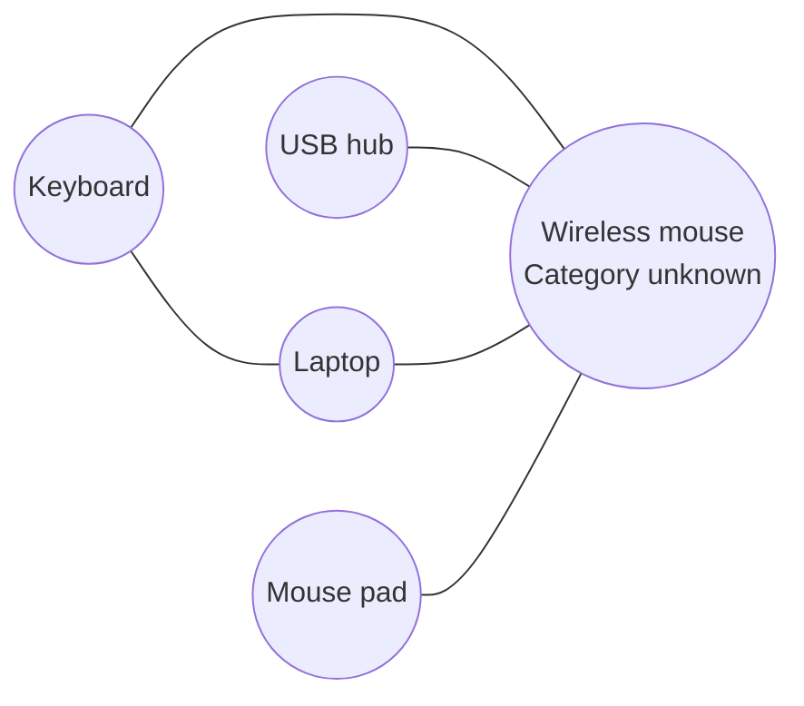
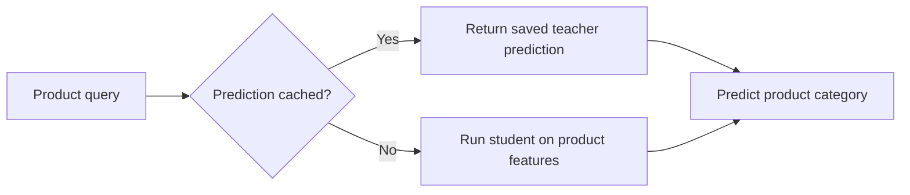

# Cache Aware GNN Distillation Architecture Techniques and Evaluation

# Abstract

Graph neural networks (GNNs) benefit from relational information, but accessing graph neighbourhoods can make inference expensive. Distilling a GNN into a feature-only multilayer perceptron (MLP) removes this dependency, although the student may not retain all of the teacher's predictive information. We investigate cache-aware GNN distillation, which combines a distilled student with a bounded cache of precomputed teacher outputs. A benefit-based policy allocates cache space using request popularity and a validation-calibrated estimate of the teacher's accuracy advantage. Cached queries reuse stored teacher predictions, while the student handles cache misses without graph traversal or online teacher execution. We also examine alternating cache selection and student refinement, reducing prediction-loss weights on cached nodes while retaining FAITH's graph-based objectives. The resulting design separates knowledge transfer into two complementary components: information learned by the student's parameters and teacher predictions retained explicitly in storage. Evaluation on real-world graph datasets examines the trade-offs among classification accuracy, cache capacity, and serving cost.

# Problem and scope

Given a graph, node features, training labels, and a cache budget, predict the class of each requested node. The central question is whether saved teacher predictions can improve the system while the student handles uncached nodes.

This report covers the completed FAITH-based study and a separately labelled reference from the earlier study without FAITH. The OGB FAITH implementation is a documented adaptation with smaller models and sampled similarity training. The two studies use different models and training protocols; their tables do not isolate FAITH's effect by itself. The failed direct-transfer configuration remains a separate record.

A separate GIANT A100 follow-up evaluates two stronger teachers selected from the OGB top ten. It uses ordinary distillation without FAITH, precomputed GIANT-XRT features, and one seed per dataset. Its accuracy recovery is reported separately from the earlier five-seed studies.

# Architecture

## Teacher and student

The GNN teacher uses node features and graph connections during offline training. Once trained, it is frozen and produces the targets used to train the student. The MLP student learns from those targets and known training labels while using only node features as its prediction input.

For the FAITH OGB adaptation, the models use the released FAITH GraphSAGE gcn-aggregator and batch-normalized MLP classes, each with three layers and 256 hidden units. The released arxiv width is 2,048; products has no released configuration. Citation models retain their released dataset-specific settings.

The GIANT follow-up uses GIANT-XRT + AGDN + BoT + self-distillation for arxiv and GIANT-XRT + SAGN + SCR for products, selected from the [OGB leaderboard](https://ogb.stanford.edu/docs/leader_nodeprop/) top ten in the 16 November 2026 snapshot. Each is distilled into a three-layer, width-256 batch-normalized MLP that takes one precomputed GIANT-XRT feature vector per node. GIANT pretraining uses text and graph structure offline; SAGN also precomputes its graph aggregation.

## Prediction cache

Each selected node ID maps to saved teacher class logits. The predicted category is the class with the highest logit. Cache hits override the student, and misses run the student. Neither path executes the teacher online.

For k cached nodes and C classes, float32 logits require 4kC bytes. A dense int64 lookup requires 8N bytes for N graph nodes. These are serving storage requirements, separate from student parameters and GPU allocator peaks. The benchmark wrapper also initializes an unused lookup for empty caches; a direct student serving path does not need it.

## Amazon products example

In ogbn-products, each node represents an Amazon product, and edges connect products frequently bought together. The task is to predict a product category. The names and connections below are illustrative; the models consume the dataset's feature vectors, not these display names.



### How distillation works

1. **Train the teacher.** The GNN learns from product features, purchase connections, and known training labels. For the mouse, connections to other computer accessories provide information beyond its own features.
2. **Freeze the teacher.** Its weights stop changing, and its category predictions are saved offline.
3. **Train the student.** The MLP learns to match the teacher's category probabilities while also learning from known training labels. It uses product features alone. FAITH adds graph-energy and similarity objectives during this training stage.

Both models learn, but at different stages. During distillation, only the student's weights change. After training, the student can predict without fetching purchase neighbours.

### How the benefit cache is selected

A 10% cache is a limit on the number of products whose teacher predictions can be stored. For the full graph:

```math
k = \lfloor 0.10 \times 2{,}449{,}029 \rfloor = 244{,}902.
```

The denominator includes all product nodes, including training, validation, and test nodes. It is not a percentage of requests, accuracy, or total server memory.

The benefit policy ranks products by **historical request frequency multiplied by predicted accuracy improvement from using the teacher**. A fixed regression model estimates that improvement from teacher/student predictions, using the separate OGB cache-calibration split. It never receives test correctness. Only products with positive predicted benefit are eligible, so capacity can remain unused.

For illustration, a product requested 1,000 times with zero predicted improvement scores 0. A product requested 500 times with predicted improvement 0.20 scores 100 and ranks higher. A frequency-only cache would prefer the first product. The experiment uses synthetic request histories rather than Amazon's production traffic.

### What happens during inference



The teacher model does not run live on either branch. A cache hit uses an answer computed beforehand; a miss runs the student. Distillation stores knowledge in student weights, while the cache stores selected teacher answers separately.

A completely new product will normally miss the cache and can be passed to the student if its features use the same representation. The reported experiment is transductive: test-product features and graph connections were available offline without their test labels. Accuracy on products arriving after training is a separate, unmeasured setting.

# Distillation and cache selection

## Training objective

The FAITH student combines supervised cross entropy on training nodes, prediction distillation from the frozen teacher, FAITH energy alignment, and Oracle Similarity Alignment (OSA):

```math
\mathcal L_S = \lambda\,\mathrm{CE}_w + (1-\lambda)\,\mathrm{KL}_w(p_T\Vert p_S) + \beta\,\mathcal L_{energy} + \gamma\,\mathcal L_{OSA}.
```

The node weights w affect only cross entropy and KL, each normalized by its corresponding weight sum. The energy and OSA terms remain intact. Temperature follows the released configuration, including its absence of a temperature-squared multiplier.

The GIANT follow-up uses ordinary distillation: 0.2 times supervised cross entropy plus 0.8 times teacher-to-student KL, with temperature 1. It does not include FAITH energy alignment, OSA, or joint cache refinement.

## Cache policies

- **Frequency:** cache products with the highest smoothed historical request counts.
- **Disagreement:** rank by frequency multiplied by teacher–student KL divergence. Disagreement alone does not identify which model is correct.
- **Benefit:** rank by frequency multiplied by nonnegative predicted teacher improvement over the student. The estimator uses prediction confidence, entropy, margins, agreement, and KL, with fixed ridge regularization.

## Joint training procedure

Joint refinement alternates cache selection using frequency times KL with student training. Cached nodes receive weight 0.1 in the supervised and prediction-distillation losses; uncached nodes receive weight 1.

Independent continuation and each joint variant start from the same saved student and receive three phases of 50 additional updates. Optimizer resets, dropout seeds, and final-step evaluation are matched. An additional control applies the joint-selected cache to the independently continued student, separating the cache choice from the training effect.

# Evaluation protocol

The FAITH-based study evaluates Cora, CiteSeer, PubMed, ogbn-arxiv, and ogbn-products, using five seeds per dataset and node-cache bounds of 1%, 5%, 10%, and 20%. Citation and OGB protocols remain separate; their dataset means are not pooled.

OGB preserves the official train and test splits. A fixed half of official validation selects checkpoints and the positive OSA coefficient; the other half calibrates cache benefit. The coefficient is chosen by model-validation accuracy over a fixed multiplicative grid, then locked across final seeds. Selection has no fairness constraint. The initial direct-transfer trial is retained, and its arxiv test results had already been observed before this exploratory follow-up. Citation cache calibration reuses the validation labels that selected checkpoints.

Requests follow synthetic Zipf popularity with exponent 0.8. Counts receive additive-one smoothing. Cache selection ranges over all graph nodes; quality and timed queries use test nodes. Standard test accuracy counts each test node equally. Request-weighted accuracy instead weights correctness by synthetic test-node popularity. These metrics are reported separately.

The FAITH OGB adaptation runs on the A100 with PyTorch 2.1.2. It uses binary undirected adjacency with self loops and a verified sparse message-sum replacement for unavailable native CUDA DGL. Full-graph sparse identities compute energy alignment, and importance-weighted common-neighbour samples approximate OSA. The quadratic graph-unfairness diagnostic is computed exactly through a separate float64 sparse factorization.

The FAITH baseline OGB runs use a maximum of 500 epochs, validation every five epochs, a minimum of 50 epochs, and patience of 50 epochs. The last validation tie replaces the checkpoint. Query timing uses 1,024 GPU-resident requests, 10 warmups, and the median of 40 synchronized calls. It includes lookup, output assembly, and student inference on misses; it excludes host transfer, network overhead, and offline cache construction.

The GIANT follow-up uses seed 42 on each OGB dataset, the official train and test splits, and a fixed validation split into checkpoint selection and independent cache calibration. Arxiv trains the graph teacher for 2,000 supervised epochs followed by 2,000 self-distillation epochs; products trains SAGN + SCR for 400 epochs. The MLP uses Adam at learning rate 0.005, all-node minibatches of 65,536, and at most 500 epochs, with validation every five epochs, a minimum of 50 epochs, and patience of 50 epochs. All three cache policies are evaluated at 1%, 5%, 10%, and 20% upper bounds. This follow-up uses native CUDA DGL 1.1.2 on the A100. Frequency-count ties use fixed-seed random tie breaking, independently of product split IDs.

# Important results

Standard test accuracy (%) is the primary metric: every test node counts equally, as in the OGB leaderboard. Both tables use a 10% node-cache upper bound. The earlier A40 and FAITH studies report five-seed means ± population standard deviations; the GIANT A100 follow-up reports one seed and is preliminary. Request-weighted results are supplementary.

## Without FAITH

Earlier A40 rows use a two-layer, width-64 GCN teacher and MLP student, with five seeds; benefit caching was not evaluated. GIANT A100 rows use stronger graph teachers and three-layer, width-256 MLP students with precomputed GIANT-XRT features, with one seed. These are separate configurations with different inputs and training protocols, so compare cache policies within each dataset and study.

| Dataset | Study | Teacher | Student without cache | Frequency cache | Disagreement cache | Benefit cache |
|---|---|---:|---:|---:|---:|---:|
| Cora | Earlier A40 | — | 79.26 ± 0.47 | 79.80 ± 0.26 | 79.94 ± 0.34 | — |
| CiteSeer | Earlier A40 | — | 73.12 ± 0.22 | 72.82 ± 0.56 | 72.74 ± 0.58 | — |
| PubMed | Earlier A40 | — | 79.82 ± 0.34 | 79.46 ± 0.35 | 79.30 ± 0.33 | — |
| ogbn-arxiv | Earlier A40 | 67.26 ± 0.11 | 50.38 ± 0.10 | 52.09 ± 0.10 | 53.01 ± 0.10 | — |
| ogbn-products | Earlier A40 | 71.63 ± 0.08 | 46.59 ± 0.08 | 49.08 ± 0.08 | 49.36 ± 0.09 | — |
| ogbn-arxiv | GIANT A100 | 76.32 | 76.07 | 76.09 | 76.14 | 76.32 |
| ogbn-products | GIANT A100 | 86.43 | 85.98 | 86.03 | 86.43 | 86.44 |

**Teacher-level accuracy in the GIANT study.** Adding a limited cache of teacher predictions recovered nearly the entire teacher–student accuracy gap on both datasets, achieving approximately teacher-level standard test accuracy in these initial single-seed experiments. On arxiv, the teacher scored 76.32% and the student-plus-benefit-cache system scored 76.32%; on products, the corresponding values were 86.43% and 86.44%. The improvement belongs to the combined system: the frozen student's weights and standalone accuracy did not change.

**Actual cache use in the GIANT study.** Under the 10% node-capacity limit, benefit caching stored 6,760 of 169,343 arxiv nodes (4.0%) and 79,339 of 2,449,029 products nodes (3.2%). The policy leaves capacity unused when predicted benefit is nonpositive. Cache hits reuse saved teacher outputs; misses run the student, with no online teacher execution.

**GIANT serving latency.** For 1,024 GPU-resident queries, median latency increased from 0.50 to 1.32 ms on arxiv and from 0.42 to 1.32 ms on products. The accuracy recovery therefore does not establish faster inference than the uncached MLP.

## With FAITH

FAITH A100 study: released citation configurations and the documented OGB FAITH adaptation. Architectures, features, teachers, seeds and training budgets differ from the studies without FAITH. Compare cache policies within each configuration; differences between studies do not measure FAITH alone.

| Dataset | Teacher | Student without cache | Frequency cache | Disagreement cache | Benefit cache |
|---|---:|---:|---:|---:|---:|
| Cora | — | 83.10 ± 0.68 | 83.16 ± 0.67 | 83.10 ± 0.41 | 82.96 ± 0.81 |
| CiteSeer | — | 63.64 ± 18.94 | 64.48 ± 16.87 | 64.46 ± 16.90 | 64.98 ± 15.97 |
| PubMed | — | 81.76 ± 0.53 | 81.56 ± 0.61 | 79.76 ± 0.52 | 81.66 ± 0.49 |
| ogbn-arxiv | 70.82 ± 0.21 | 63.42 ± 0.19 | 64.21 ± 0.18 | 65.91 ± 0.15 | 67.81 ± 0.15 |
| ogbn-products | 77.59 ± 0.15 | 68.40 ± 0.15 | 69.31 ± 0.15 | 70.83 ± 0.17 | 72.85 ± 0.13 |

**Accuracy benefit.** Benefit caching improves standard accuracy on both OGB datasets by about 4.4 percentage points. This is a gain for the combined student-plus-cache system; the independently distilled student weights are unchanged in this comparison. The large CiteSeer variation includes the failed base seed, which remains in every mean.

**FAITH latency and graph smoothness.** OGB benefit-cache query batches take about 0.86–0.87 ms, compared with about 0.45 ms for the uncached student. The measured accuracy gain is accompanied by higher local serving latency. Exact graph unfairness improves slightly for arxiv benefit caching and worsens for products; the accuracy gain does not consistently preserve graph smoothness.

## Supplementary workload metrics

**FAITH request-weighted accuracy.** Under the synthetic workload, benefit caching changes arxiv accuracy from 65.05% to 71.52%, and products from 68.73% to 76.20%. These are workload-specific metrics, not leaderboard accuracy.

**FAITH request routing.** In the products FAITH benefit-cache run, cached teacher answers cover about 21.7% of synthetic test requests; the student serves the remaining 78.3%. About 10.3% of test products are cached when test products are counted equally. The teacher therefore does not supply most predictions, and its model does not execute online.

**FAITH joint refinement.** Against the equally trained disagreement-cache control at 10%, joint refinement changes request-weighted accuracy by approximately +0.12 points on arxiv and −0.04 points on products. Applying benefit caching to joint rather than independently continued students adds essentially no gain in these OGB runs.

**GIANT request-weighted accuracy.** Under the synthetic Zipf workload, benefit caching changes arxiv from 74.69% to 74.49%, and products from 85.13% to 85.54%. These supplementary results describe the assumed request workload; standard test accuracy is the primary comparison.

# Interpretation and limitations

Teacher predictions can replace correct student predictions as well as mistakes. Benefit estimation uses validation correctness to distinguish these cases, but it remains an estimate under workload and data shifts.

The evaluation covers static graphs and static cache snapshots. It does not measure live eviction, refresh, stale predictions, production traffic, or accuracy on products arriving after training. OSA training uses a fixed similarity sample, and the seed variation does not measure uncertainty from that sampling. The study makes no statistical-significance or state-of-the-art claim.

The OGB extension is not a reproduction of the paper's published result: width, graph preprocessing, similarity computation, coefficient selection, and validation allocation differ. The citation reproduction also retains its unstable CiteSeer seed. These conditions qualify the comparisons rather than being resolved by selecting successful seeds.

# Next experiments

1. Evaluate genuinely new products with a separate inductive split.
2. Repeat the GIANT teacher and student experiments across multiple training and workload seeds, then evaluate a matched FAITH variant.
3. Test real request traces, changing popularity, cache refresh, and graph updates.
4. Profile lookup and output assembly, and compare policies under a fixed byte budget.

# Reproducibility and source artifacts

The FAITH-based study contains 1,150 evaluation rows, including 460 OGB rows. The table without FAITH uses separate saved A40 experiments, with source hashes recorded in the reference provenance file. Independent checks reconstruct OGB FAITH standard, request-weighted, and shifted accuracy and hit rates from saved predictions, exact cache indices, and workloads. They also check source/data hashes, split separation, cache capacities, and equal refinement updates. Source-loss and sparse-operation checks cover values and gradients; the raw experiment artifacts are retained.

The GIANT follow-up adds 26 evaluation rows across two datasets, one seed, and four cache upper bounds. Independent reconstruction verifies 130 accuracy and hit-rate values from saved predictions, workloads, and cache indices. Restored student weights reproduce every saved student prediction; teacher checkpoint predictions, source hashes, and feature hashes are also verified. Its detailed report and evidence are in `faith-cache-research/results/leaderboard_cache/REPORT.md`, `metrics.csv`, `independent_verification.json`, and `checkpoint_verification.json`.

- [OGB metrics](results/faith_ogb/metrics.csv)
- [OGB independent verification](results/faith_ogb/independent_verification.json)
- [Exact graph fairness data](results/faith_ogb/exact_fairness.json)
- [Citation metrics](results/faith_cache/metrics.csv)
- [Reference provenance without FAITH](results/legacy_no_faith_reference/provenance.json)
- [FAITH authors' code](https://github.com/shashivipul/FAITH)
- [FAITH paper](https://ojs.aaai.org/index.php/AAAI/article/view/39744)
- [OGB dataset documentation](https://ogb.stanford.edu/docs/nodeprop/)

- [GIANT stronger teacher study](results/leaderboard_cache/REPORT.md)
- [GIANT metrics](results/leaderboard_cache/metrics.csv)
- [GIANT accuracy verification](results/leaderboard_cache/independent_verification.json)
- [GIANT checkpoint verification](results/leaderboard_cache/checkpoint_verification.json)
