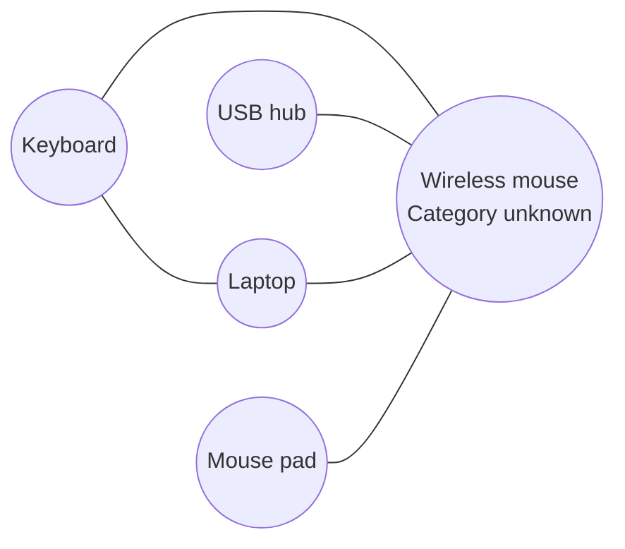
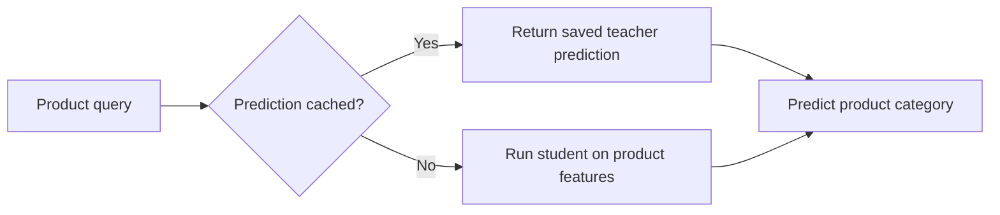

## Amazon products example

In ogbn-products, each node represents an Amazon product, and edges connect products frequently bought together. The task is to predict a product category. The names and connections below are illustrative; the models consume the dataset's feature vectors, not these display names.



### How distillation works

1. **Train the teacher.** The GNN learns from product features, purchase connections, and known training labels. For the mouse, connections to other computer accessories provide information beyond its own features.
2. **Freeze the teacher.** Its weights stop changing, and its category predictions are saved offline.
3. **Train the student.** The MLP learns to match the teacher's category probabilities while also learning from known training labels. It uses product features alone. FAITH adds graph-energy and similarity objectives during this training stage.

Both models learn, but at different stages. During distillation, only the student's weights change. After training, the student can predict without fetching purchase neighbours.

### How the benefit cache is selected

A 10% cache is a limit on the number of products whose teacher predictions can be stored. For the full graph:

```math
k = \lfloor 0.10 \times 2{,}449{,}029 \rfloor = 244{,}902.
```

The denominator includes all product nodes, including training, validation, and test nodes. It is not a percentage of requests, accuracy, or total server memory.

The benefit policy ranks products by **historical request frequency multiplied by predicted accuracy improvement from using the teacher**. A fixed regression model estimates that improvement from teacher/student predictions, using the separate OGB cache-calibration split. It never receives test correctness. Only products with positive predicted benefit are eligible, so capacity can remain unused.

For illustration, a product requested 1,000 times with zero predicted improvement scores 0. A product requested 500 times with predicted improvement 0.20 scores 100 and ranks higher. A frequency-only cache would prefer the first product. The experiment uses synthetic request histories rather than Amazon's production traffic.

### What happens during inference



The teacher model does not run live on either branch. A cache hit uses an answer computed beforehand; a miss runs the student. Distillation stores knowledge in student weights, while the cache stores selected teacher answers separately.

A completely new product will normally miss the cache and can be passed to the student if its features use the same representation. The reported experiment is transductive: test-product features and graph connections were available offline without their test labels. Accuracy on products arriving after training is a separate, unmeasured setting.
