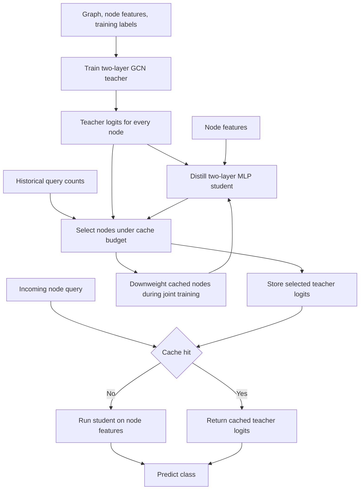

# Cache Aware GNN Distillation Architecture Techniques and Evaluation

# Abstract

Graph neural network distillation reduces dependence on graph computation at inference, but a feature-only student may lose predictive information available to its teacher. We investigate cache-aware distillation, which augments a two-layer MLP student with a bounded cache of logits from a two-layer GCN teacher. The method alternates between selecting nodes according to historical query frequency and teacher–student disagreement, and training the student with reduced loss weights on cached nodes. We evaluate seven real graph datasets using five seeds and cache budgets of 1%, 5%, 10%, and 20% under synthetic Zipf query workloads. At a 10% cache budget, frequency-based caching improves request-weighted accuracy from 50.68% to 59.36% on ogbn-arxiv and from 46.80% to 61.54% on ogbn-products; joint training reaches 59.19% and 60.12%, respectively. Caching improves accuracy on five of seven datasets, but joint training provides no consistent advantage over simpler cache policies. Cached query routing also increases batch latency relative to the uncached student. These results demonstrate the potential accuracy benefit of retaining teacher outputs while identifying teacher reliability and routing overhead as key constraints on effective cache-aware distillation.

# Problem and scope

Given a graph, node features, a limited set of training labels, and a memory budget, predict node classes for a stream of node queries. A GCN teacher accesses graph neighborhoods during offline training. A smaller MLP student uses only node features at query time. A cache stores selected teacher logits so that repeated queries can reuse graph-derived information.

The prototype evaluates static graphs and static cache snapshots. It stores class logits, rather than intermediate teacher embeddings. It does not execute the teacher on a cache miss, refresh stale entries, or implement an online eviction service. These choices define the system whose results are reported.

# Architecture



The upper portion runs offline. The serving path performs a node-to-slot lookup, returns stored logits on a hit, and applies the MLP only to misses. The predicted class is the argmax of the returned logits. Cache hits always override the student; there is no learned gate that can reject a teacher prediction.

## GCN teacher

The teacher has two graph convolution layers with 64 hidden units, ReLU, and dropout probability 0.5 during training. With normalized adjacency S, node features X, weights W, and biases b, its evaluation-time computation is:

```math
S = \widetilde D^{-1/2}(A+I)\widetilde D^{-1/2},\qquad
H = \operatorname{ReLU}(SXW_1+b_1),\qquad Z_T = SHW_2+b_2.
```

Training inserts dropout after the ReLU. Teacher parameters minimize cross entropy on training labels. Adam uses learning rate 0.01 and weight decay 0.0005; the checkpoint with lowest validation cross entropy supplies teacher logits.

The smaller graphs use PyG GCNConv. OGB uses native sparse CSR matrix multiplication to avoid allocating an intermediate hidden vector for every edge. OGB features retain their original values; the five smaller datasets use NormalizeFeatures.

For static OGB graphs, the optional prepropagation step computes SX once. The identity (SX)W = S(XW) preserves the first-layer function and parameter gradients for this implementation. Equivalence checks cover both outputs and gradients. This is an offline training optimization, separate from the prediction cache.

## MLP student and prediction cache

The student has two fully connected layers with 64 hidden units, ReLU, and training dropout 0.5. It has no graph input:

```math
Z_S = \operatorname{ReLU}(XU_1+c_1)U_2+c_2.
```

For a cache containing k nodes and C classes, the compact float32 logit payload uses 4kC bytes. A dense int64 lookup array maps each node ID to a cache slot or a miss marker and uses 8N bytes for N graph nodes. Student weights, cache payload, and lookup storage are accounted for separately.

The nominal budget is a fraction of all nodes: k = max(1, floor(bN)), with b in 1%, 5%, 10%, and 20%. It is therefore a node-count budget whose byte cost depends on the number of classes, rather than one common byte budget across datasets.

# Distillation and cache selection

## Training objective

The teacher target for node v is its temperature-scaled probability vector pT, using temperature tau = 2. The student learns from teacher targets on all graph nodes and ground-truth labels on training nodes only:

```math
\mathcal L = 0.8\,\tau^2
\frac{\sum_{v\in V}w_v\,D_{KL}(p_{T,v}\Vert p_{S,v})}{\sum_{v\in V}w_v}
+0.2\,
\frac{\sum_{v\in V_{train}}w_v\,CE(y_v,Z_{S,v})}{\sum_{v\in V_{train}}w_v}.
```

Independent distillation sets every weight to 1. Joint training sets the weight of currently cached nodes to 0.1, leaving other nodes at 1. The same weights affect both distillation and supervised terms. Adam uses the teacher learning rate and weight decay.

This is transductive distillation: features, graph structure, and teacher soft targets are available for test nodes offline. Ground-truth test labels are used only for evaluation.

## Joint training procedure

1. Train a common student for 150 full-graph optimizer steps.

2. Select k cached nodes using historical frequency multiplied by teacher–student disagreement.

3. Train the joint student for another 150 steps with cached nodes weighted by 0.1.

4. Repeat selection and training for three continuation phases, then select the final cache.

Every independent and joint student receives 600 optimizer steps. The independent student follows the same phase schedule with uniform weights. Continuation phases reset the optimizer and use matched random seeds; all joint budget branches start from the same 150-step base student.

The selection score uses smoothed historical counts n_v and KL disagreement at temperature 2:

```math
s_v=n_v\max\!\left(0,D_{KL}(p_{T,v}\Vert p_{S,v})\right),\qquad
\mathcal C=\operatorname{TopK}_v(s_v).
```

The cache policy is a discrete heuristic coupled to alternating student training. It is not a separately trained neural cache controller or a differentiable optimization of serving latency. Disagreement measures imitation difficulty; it does not establish that the teacher is more accurate.

## Baselines and controls

| Method | Student training | Cache selection |
|---|---|---|
| Supervised MLP | Training labels only, 600 steps | None |
| Distilled MLP | Uniform distillation, 600 steps | None |
| Frequency cache or LFU | Independent distilled student | Highest smoothed historical counts |
| Recency cache or LRU | Independent distilled student | Most recently observed nodes |
| Disagreement cache | Independent distilled student | Frequency times teacher–student KL |
| Joint training | Alternating selection and weighted training | Frequency times current student disagreement |
| Independent student with joint cache | Independent distilled student | Final cache selected by the joint method |

LFU and LRU are static snapshots of historical requests. The independent-student/joint-cache control helps separate the effect of choosing a different cache from the effect of weighted student training.

# Evaluation protocol

## Datasets and splits

| Dataset | Nodes | Input features | Classes | Training and evaluation split |
|---|---:|---:|---:|---|
| Cora | 2,708 | 1,433 | 7 | Public Planetoid |
| CiteSeer | 3,327 | 3,703 | 6 | Public Planetoid |
| PubMed | 19,717 | 500 | 3 | Public Planetoid |
| Amazon Computers | 13,752 | 767 | 10 | 20 training and 30 validation nodes per class |
| Amazon Photo | 7,650 | 745 | 8 | 20 training and 30 validation nodes per class |
| ogbn-arxiv | 169,343 | 128 | 40 | Official time split |
| ogbn-products | 2,449,029 | 100 | 47 | Official sales ranking split |

The Amazon split uses seed 42 and assigns all remaining nodes to testing. Five training seeds reuse that split, so their variability does not measure variation across data splits. Citation datasets preserve their public masks; nodes outside those masks remain available for transductive computation.

The OGB loader constructs undirected binary adjacency with self loops and symmetric degree normalization. It uses the official train, validation, and test indices. Full-graph training fits on an A40; no neighborhood sampling is used.

## Workload and accuracy measures

Requests follow a synthetic Zipf distribution with exponent 0.8, assigning ranks to nodes through a random permutation. Historical request counts receive additive smoothing of 1. The five smaller datasets use 100,000 historical requests; OGB uses max(100,000, 10N). Cache selection ranges over all graph nodes, while quality metrics and timed queries use test nodes.

Uniform accuracy weights each test node equally. Request-weighted accuracy weights correctness by test-node popularity, renormalized over the test set. Shifted accuracy averages the original popularity vector with its reversal while retaining the same cache. That is a controlled synthetic shift, not a real traffic trace.

The headline tables report mean request-weighted accuracy across five seeds. Each seed changes model training randomness and synthetic workload randomness. Standard deviations therefore reflect both sources.

## Teacher stopping rules and hardware

The main five-dataset results use a 3,000-epoch teacher limit, at least 400 epochs, and validation patience of 200 epochs. All 25 teachers stop before the cap.

The main arxiv results use the longer teacher check: a 3,000-epoch cap, at least 200 epochs, validation checks every 5 epochs, and patience 200. Teachers stop after 1,561–2,061 epochs. An earlier 1,000-epoch arxiv run is retained separately and yields the same qualitative conclusion.

Products uses a 1,000-epoch cap, at least 200 epochs, validation checks every 5 epochs, and patience 100. All five products teachers reach the cap; their reported checkpoints are validation-selected within that budget. Full teacher convergence is not established for products.

Recorded GPU experiments use NVIDIA A40 hardware with PyTorch 2.10.0+cu130 and CUDA 13.0. Products seeds were split across two A40s. Peak allocated products GPU memory is approximately 13.95 GiB, including training and evaluation state. The later A100 CUDA access check establishes current hardware availability, not a new benchmark result.

# Accuracy results

## Main comparison at 10 percent cache

Values are percentages, mean ± sample standard deviation across five seeds. No cache refers to the independently distilled MLP.

| Dataset | No cache | Frequency cache | Disagreement cache | Joint training |
|---|---:|---:|---:|---:|
| Cora | 79.55 ± 2.67 | 83.60 ± 1.80 | 83.02 ± 2.18 | 82.93 ± 1.92 |
| CiteSeer | 74.94 ± 3.81 | 70.95 ± 4.15 | 70.86 ± 4.32 | 70.90 ± 4.54 |
| PubMed | 80.54 ± 3.98 | 79.64 ± 4.52 | 79.98 ± 4.15 | 79.78 ± 4.35 |
| AmazonComputers | 62.63 ± 2.91 | 64.99 ± 1.74 | 66.99 ± 1.90 | 65.88 ± 2.21 |
| AmazonPhoto | 78.15 ± 5.14 | 81.91 ± 2.83 | 81.98 ± 2.76 | 82.06 ± 2.52 |
| ogbn-arxiv | 50.68 ± 1.92 | 59.36 ± 1.86 | 59.27 ± 1.92 | 59.19 ± 1.82 |
| ogbn-products | 46.80 ± 0.65 | 61.54 ± 0.64 | 59.98 ± 0.65 | 60.12 ± 0.63 |

Frequency caching raises arxiv accuracy by 8.68 percentage points and products accuracy by 14.74 points over their uncached distilled students. Joint training trails frequency caching by 0.17 points on arxiv and 1.42 points on products.

Disagreement caching is strongest among the four displayed methods on Amazon Computers. Joint training has the largest mean on Amazon Photo, but its 0.08-point margin over disagreement caching is small relative to the seed variation. No statistical significance claim is made.

CiteSeer and PubMed favor the uncached student. Because the serving path always substitutes teacher logits on a hit, a teacher mistake can replace a correct student prediction.

## OGB cache budget sweep

Mean request-weighted accuracy in percent:

| Dataset | Cache fraction | Frequency cache | Disagreement cache | Joint training |
|---|---:|---:|---:|---:|
| ogbn-arxiv | 1% | 55.19 | 55.18 | 55.15 |
| ogbn-arxiv | 5% | 57.92 | 57.92 | 57.85 |
| ogbn-arxiv | 10% | 59.36 | 59.27 | 59.19 |
| ogbn-arxiv | 20% | 60.98 | 61.08 | 60.99 |
| ogbn-products | 1% | 55.58 | 54.66 | 54.70 |
| ogbn-products | 5% | 59.48 | 58.09 | 58.22 |
| ogbn-products | 10% | 61.54 | 59.98 | 60.12 |
| ogbn-products | 20% | 63.82 | 62.47 | 62.56 |

Products frequency caching has the highest mean among these three methods at every tested cache fraction. Arxiv disagreement caching narrowly exceeds frequency caching at 5% and 20%. Joint training does not lead either OGB dataset at any tested budget among these policies.

At 10% cache, products joint training exceeds disagreement caching by 0.14 points, while remaining below frequency caching. This distinction matters: an improvement over disagreement alone is insufficient to establish superiority over a simpler cache baseline.

## Supervised student control

The first two columns are request-weighted accuracies. The teacher column is uniform test accuracy and has a different weighting, so it should not be interpreted as a direct teacher–student gap.

| Dataset | Supervised MLP | Distilled MLP | GCN teacher uniform accuracy |
|---|---:|---:|---:|
| Cora | 59.17 | 79.55 | 81.58 |
| CiteSeer | 60.69 | 74.94 | 71.74 |
| PubMed | 75.50 | 80.54 | 79.38 |
| AmazonComputers | 58.24 | 62.63 | 66.32 |
| AmazonPhoto | 74.66 | 78.15 | 85.38 |
| ogbn-arxiv | 50.68 | 50.68 | 67.26 |
| ogbn-products | 53.62 | 46.80 | 71.63 |

On products, the supervised MLP reaches 53.62% request-weighted accuracy versus 46.80% for the distilled MLP. The current distillation configuration is therefore a weak starting point on that dataset. The experiment does not include a supervised MLP combined with the same caches; that comparison is needed before claiming the best cache-assisted student configuration.

Teacher uniform accuracy on products is 71.63%, while the prototype arxiv teacher reaches 67.26%. These are controlled two-layer, 64-unit models rather than reproductions of stronger published OGB reference models.

# Query latency and memory

## Measured query latency

Mean across seeds of per-seed median batch latency, in milliseconds, for 1,024 GPU-resident test-node queries:

| Dataset | Uncached student | Frequency cache | Joint training |
|---|---:|---:|---:|
| Cora | 0.213 | 0.495 | 0.495 |
| CiteSeer | 0.222 | 0.473 | 0.472 |
| PubMed | 0.194 | 0.499 | 0.499 |
| AmazonComputers | 0.220 | 0.648 | 0.655 |
| AmazonPhoto | 0.229 | 0.582 | 0.586 |
| ogbn-arxiv | 0.136 | 0.445 | 0.445 |
| ogbn-products | 0.082 | 0.324 | 0.325 |

Each timing uses 10 warmup calls and 40 synchronized repetitions. Cached timing includes the lookup, result assembly, and MLP inference on misses. It excludes host transfer, networking, cache refresh, and service overhead.

At 10% cache, joint routing takes approximately 3.3 times the uncached batch time on arxiv and 3.9 times on products. These measurements establish no latency gain over the uncached MLP. The extra lookup, masking, and output assembly are plausible sources of overhead, but their separate contributions were not profiled.

Full-graph teacher forward timing covers all nodes, whereas student serving timing covers a query batch. Their ratio is not a valid serving speedup.

## Serving storage at 10 percent cache

| Dataset | Cached logits MiB | Lookup index MiB | Student weights KiB |
|---|---:|---:|---:|
| ogbn-arxiv | 2.58 | 1.29 | 42.41 |
| ogbn-products | 43.91 | 18.68 | 37.18 |

On products, the logit payload is about 43.91 MiB and the dense lookup adds about 18.68 MiB. The lookup is meaningful overhead even though it is outside the nominal node-logit payload budget.

The optional first-layer prepropagation array requires about 82.69 MiB on arxiv and 934.23 MiB on products. It is offline teacher state and is not required by the student/cache serving path. Reported teacher forward timing with prepropagation excludes its one-time construction cost.

# Interpretation and limitations

The experiments support a narrower result than the original joint-training hypothesis: static teacher-logit caching can improve request-weighted accuracy when the teacher is useful for popular queried nodes. They do not show a consistent advantage from alternating cache selection with student training.

Several mechanisms remain unresolved. Frequency times KL targets disagreement, which can select teacher errors as well as useful teacher knowledge. Downweighting cached nodes also assumes that their teacher overrides are beneficial. The synthetic popularity distribution is independent of semantic difficulty, so the value of a real deployment cache may differ.

The evaluation has additional boundaries: static graphs and cache snapshots; one Amazon split per dataset; four cache fractions; fixed prototype model sizes and loss weights; capped products teachers; no ground-truth test-label selection; and no production traffic, refresh, or stale-cache measurements. CUDA sparse reductions may be nondeterministic. The study reports seed variability without confidence intervals or significance tests.

The best available evidence does not establish a new state-of-the-art method, an online caching advantage, or a serving speedup.

# Next experiments

1. Add validation-calibrated selective overrides so a hit can retain the student prediction when the teacher is unlikely to help. Validate the gate without using test labels.

2. Compare cache policies on both supervised and distilled students, especially on products. First determine whether distillation improves the student being augmented.

3. Replace disagreement alone with an estimate of teacher improvement over the student, weighted by request frequency. Preserve simple LFU as a primary baseline.

4. Profile lookup and batch assembly, then evaluate implementations that reduce their overhead. Count both payload and index bytes under a fixed byte budget.

5. Repeat products with a longer teacher stopping schedule or a stronger teacher, and test multiple Amazon splits, real request traces, workload shifts, and graph updates.

Each experiment should report accuracy together with end-to-end query cost and memory. A useful follow-up method must beat the strongest simple baseline under the same student training and resource budgets.

# Reproducibility and source artifacts

The primary comparison contains 22 settings per seed: two no-cache controls and five cached methods at each of four cache fractions. Five seeds across seven datasets give 770 rows. The original five-dataset fixed-budget run and the original arxiv capped run remain separate from this main comparison.

Saved verification records check seed and setting coverage, finite accuracy values, equal 600-step student budgets, split disjointness in the data loaders, and agreement between the quality-evaluation predictions and the actual query route. OGB result JSON and CSV values were rechecked for consistency; the merged products results match their source parts. These are checks of saved results, not new training runs.

Implementation sources:

- `/home/mshanthappa/distill-cache-research/real_graph.py`: teacher, student, weighted KD, cache selection, serving, and small-graph evaluation.

- `/home/mshanthappa/distill-cache-research/ogb_prepare.py`: OGB data preparation.

- `/home/mshanthappa/distill-cache-research/ogb_experiment.py`: sparse teacher, equivalence checks, prepropagation, and OGB runs.

- `/home/mshanthappa/distill-cache-research/ogb_merge.py`: disjoint seed merging and validation.

Primary result directories:

- `/home/mshanthappa/distill-cache-research/results/five_datasets_converged`

- `/home/mshanthappa/distill-cache-research/results/ogb/arxiv_convergence_check`

- `/home/mshanthappa/distill-cache-research/results/ogb/products`

Each directory contains a report, per-seed metrics, configuration, and environment records. The first two also preserve teacher traces in their dataset-specific naming formats; the products directory retains merged traces from both GPU parts. These paths refer to local artifacts and require access to the workspace.


