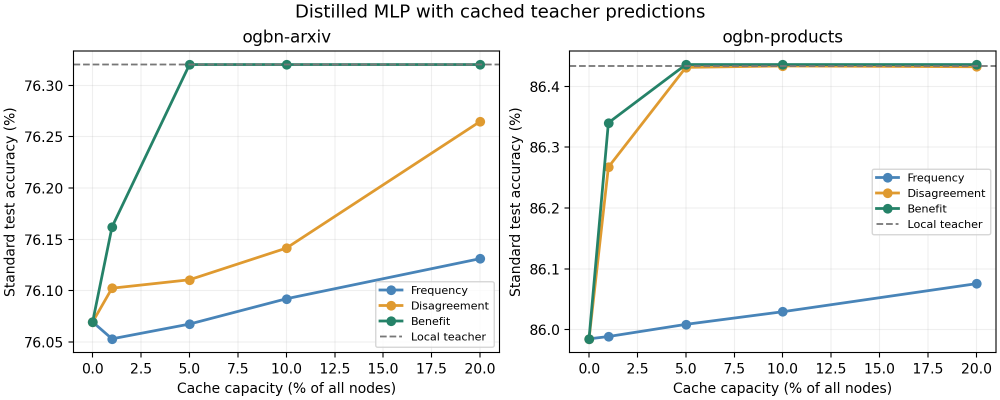

# Top-ten OGB teachers with distillation and prediction caching

Selected from the [official OGB leaderboard](https://ogb.stanford.edu/docs/leader_nodeprop/) on 16 November 2026. Both teachers are ranked seventh. Published values are external reference scores; the other columns below are locally measured. This study uses ordinary distillation, without FAITH graph objectives.

The teacher follows the authors’ architecture and training recipe. Half of the official validation split is reserved exclusively for cache calibration, which differs from the published full-validation protocol. The feature-only student is a three-layer, width-256 MLP with batch normalization and dropout 0.1. It uses the same precomputed GIANT-XRT node embeddings as the teacher, but no neighbor aggregation or online teacher call. GIANT pretraining itself used graph structure and text; this is not the original raw-feature student experiment.

Teacher details: arxiv uses the released native-DGL AGDN training routine, 2,000 supervised epochs followed by 2,000 graph self-distillation epochs, RMSprop at 0.01. Products uses released SAGN models and supervised/SCR update functions, 400 epochs, 100 warmup epochs, Adam at 0.001, and the published confidence schedule. Product features use three row-mean propagation hops; training labels use nine. SAGN itself precomputes graph aggregation, so these measurements do not establish a speedup over an optimized SAGN serving system. We save the best EMA state explicitly to avoid the released code applying final EMA parameters to an earlier best model.

## Primary result: standard test accuracy

Percent. Cache capacity is 10% of all graph nodes. All cache policies use the same frozen student and teacher. A gain is relative to that student without a cache and is calculated before rounding the displayed accuracies. Multiple completed seeds are summarized as mean ± population standard deviation; single-seed values are preliminary.

| Dataset | Teacher | Published teacher | Local teacher | Distilled MLP | Frequency cache | Disagreement cache | Benefit cache | Benefit gain (pp) | Seeds |
|---|---|---:|---:|---:|---:|---:|---:|---:|---:|
| ogbn-arxiv | GIANT-XRT + AGDN + BoT + self-KD | 76.37 | 76.32 | 76.07 | 76.09 | 76.14 | 76.32 | 0.25 | 1 |
| ogbn-products | GIANT-XRT + SAGN + SCR | 86.67 | 86.43 | 85.98 | 86.03 | 86.43 | 86.44 | 0.45 | 1 |

## Separate workload and serving measurements

Request-weighted accuracy uses synthetic Zipf(0.8) popularity, with 100,000 history requests and additive-one count smoothing. Frequency ties are broken pseudorandomly with fixed seed 7341, independently of the contiguous product split IDs; all strict frequency rankings are preserved. These values must not be compared with OGB leaderboard test accuracy. Cache selection uses history and model outputs; benefit regression uses only the reserved calibration labels. It may leave capacity unused when predicted benefit is nonpositive.

| Dataset | Uncached weighted accuracy | Benefit weighted accuracy | Teacher request hit rate | Uncached latency (ms) | Benefit latency (ms) |
|---|---:|---:|---:|---:|---:|
| ogbn-arxiv | 74.69 | 74.49 | 3.39 | 0.50 | 1.32 |
| ogbn-products | 85.13 | 85.54 | 3.19 | 0.42 | 1.32 |

Latency is a GPU microbenchmark of 1,024 already-resident requests, including lookup, output assembly, and miss-only student inference. It excludes text encoding, host transfer, graph/teacher preprocessing, refresh, and network costs. It is measured with 10 warmups and 40 synchronized repetitions. A higher cache accuracy does not establish a latency improvement.

## Evidence and limitations

26 evaluation rows are complete. Independent reconstruction checked 130 quality/hit-rate values from saved predictions, cache indices, and workloads. Budgets of 1%, 5%, 10%, and 20% are retained in the raw metrics. Test labels did not select checkpoints, cache nodes, or training settings.

Training: student cross entropy and teacher KL have weights 0.2 and 0.8, temperature 1; Adam learning rate 0.005; all-node minibatches of 65,536; maximum 500 epochs; model-validation selection every five epochs; minimum 50 epochs and patience 50 epochs. Each teacher/student seed is paired with a fixed synthetic workload.

This measures recovery of a distilled student’s accuracy through cached teacher predictions. It does not imply that caching improves the teacher itself or exceeds the leaderboard. Results are transductive and do not evaluate truly new nodes or a changing request stream.

Artifacts: `metrics.json`, `metrics.csv`, `independent_verification.json`, `status.json`, and per-seed teacher/student checkpoints, selected splits, prediction vectors, cache indices, workload history, calibration coefficients, training traces, and source hashes. Official implementations are under `leaderboard-upstream/AGDN` and `leaderboard-upstream/SCR`.
